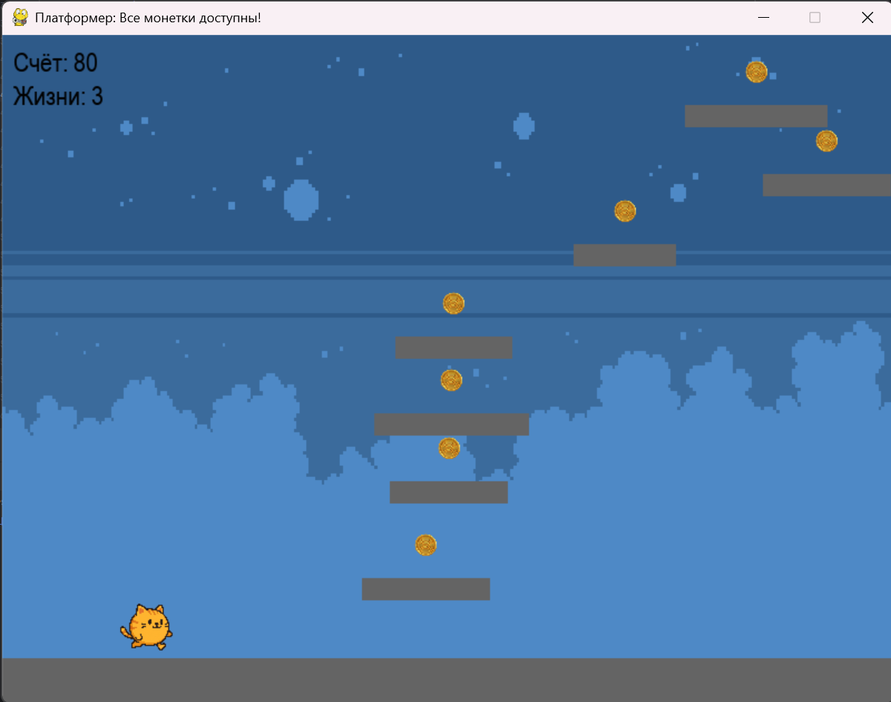

# 2D Platformer

2D-платформер, разработанный в рамках учебного проекта. Игрок управляет персонажем, собирает предметы и избегает препятствий.

## 🎮 Скриншоты


## 🚀 Установка и запуск

1. Клонируйте репозиторий:
   ```bash
   git clone https://github.com/neskubov/2D-platform.git
   cd 2D-platform
   
2. Установите зависимости:

    ```bash
    pip install -r requirements.txt
    Запустите игру:

3.Запустите игру:
    ```bash
    python main.py

## 🕹️ Управление
- **Стрелка влево / A** — движение влево
- **Стрелка вправо / D** — движение вправо
- **Пробел** — прыжок

## 🛠 Технологии
- Python 3
- Pygame — библиотека для создания игр

## 📁 Структура проекта
2D-platform/\
├── images/ # Спрайты и текстуры\
├── sounds/ # Звуковые эффекты и музыка\
├── main.py # Основной файл запуска\
├── game.py # Основная логика игры\
├── requirements.txt # Зависимости\
└── README.md # Описание проекта

## 👥 Командная работа
Проект выполнен в рамках учебной программы.
